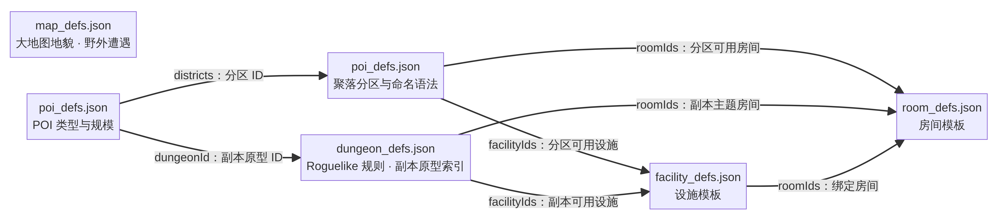
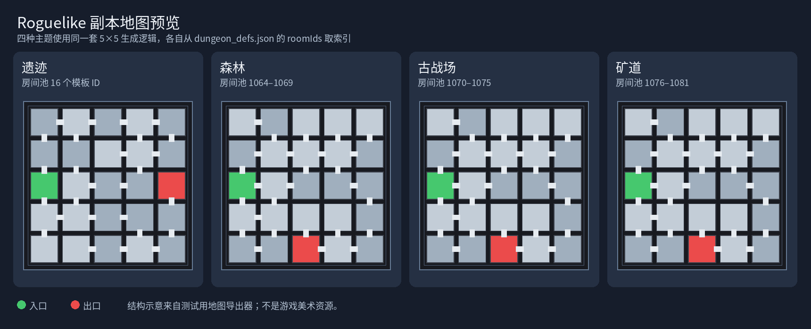

# 地图与 POI 数据表

地图生成配置按地貌、房间、设施、POI 与 Roguelike 副本原型拆成五份 JSON 表。运行时由 `MapCatalog` 统一读取：

- `content/map_defs.json`：大地图地貌与野外遭遇，只保留 `terrains`、`wilds`。野外遭遇条目只写叙事字段（`title`、`text`、`terrains`、`weight`、`minTier`、`detourMinutes`……）；战斗条目写 `families`（怪物族群），阵容由遭遇生成器现组，不再写死 `foes`。
- `content/room_defs.json`：POI 与 Roguelike 副本房间模板。每行以 `id` 标识，包含 `category`、`name`、`terrain` 和 `defaultPool`。
- `content/facility_defs.json`：POI 与副本设施模板。每行以 `id` 标识，包含 `name`、`terrain`、`defaultPool` 和 `roomIds`；`roomIds` 引用设施可附属的房间模板。非战斗探索事件写在设施的 `event` 中，可配置金币、耗时、心情与战利品表。
- `content/poi_defs.json`：POI 规模、聚落分区关系及命名语法。`pois[].districts` 引用分区 ID；副本型 POI 用 `dungeonId` 引用副本原型。分区的 `roomIds`、`facilityIds` 分别引用可用房间和设施，设施还必须通过自身的 `roomIds` 绑定到该分区内至少一种房间。
- `content/dungeon_defs.json`：全局副本拼块/遭遇规则、委托地点与副本原型索引。`dungeons[]` 每项以 `id` 标识，`roomIds` 与 `facilityIds` 引用该原型可用的房间与设施；委托地点和固定地城委托也以 `dungeonId` 选择原型。`rules.guards[]` / `rules.bosses[]` 是守卫房 / 首领房的遭遇条目（叙事＋`families`），委托板正主的 CR 加码写在 `rules.quest.board.crPerStar`。

怪物不在以上五份表里，而在 Def 表 `content/defs/monsters.json`（怪物模板，`MonsterDef`）与 `content/defs/challenge.json`（挑战等级规则，`ChallengeDef`）。模板的栖息标签反向引用地图表：`dungeons` → `dungeon_defs.json dungeons[].id`，`rooms` → `room_defs.json` 的 `terrain`，`terrains` → `map_defs.json terrains[].type`。遭遇时按危险等级取 CR 窗口，从「CR 索引 ∩ 栖息地索引 ∩ 条目族群」里组队；字段、CR 取值与构成规则见 [`怪物表规范.md`](怪物表规范.md)。

这里的“副本”指 Roguelike 探索实例，不限于地下建筑：遗迹、森林、古战场、矿道等都由同一生成流程驱动，各主题只需提供自己的房间/设施 ID 池。

> 关系图源文件 `地图数据表结构.mmd` 已补上怪物模板表、挑战等级表与委托表的引用；`地图数据表结构.png` 仍是旧图（沙箱里装不上 mermaid 渲染所需的浏览器，未重新出图），以 `.mmd` 为准。

`defaultPool` 表示模板是否参与未指定分区时的通用抽样；设施只有在绑定房间模板被选中时才会附着，不单独占格。房间和设施 ID 各自在本表内唯一，所有跨表引用必须存在；分区可用设施至少绑定到该分区的一种房间，副本可用设施至少绑定到该副本的一种房间。副本生成器按 `dungeonId` 读取原型的 `roomIds`，房间索引不再借用 POI 分区索引。

副本房间模板只描述空间类型；房间本身只直接生成守卫或首领遭遇（守卫按房间地形筛怪，首领房＝出口，地形固定为 `Road`），宝箱、祭坛、遗骸、机关等非战斗内容必须配置为附属设施事件。设施事件不允许声明敌人；物品掉落沿用战斗 `LootGenerator` 行格式（物品、数量区间、百分比掉率）。全局拼块与遭遇规则由 `dungeon_defs.json` 的 `rules` 驱动，主题房间池则按各自副本原型的 `roomIds` 抽取。

`MapCatalog.CreateDefault()` 与 Godot 内容提供器按文件名加载这五份表；任意一份缺失都会明确报错，不回退到旧的单表配置或内置数据。POI 房间实例保留设施 ID；房间和设施模板仍分表存储，生成时设施作为房间附属内容挂载，不转换成独立房间模板。

这里的房间/设施表指大地图 POI 与副本生成模板，不是领地建造系统的 `RoomDef` / `FacilityDef`。领地建造数据仍由 `content/defs/buildings.json` 装载；本次没有改变该系统格式。
